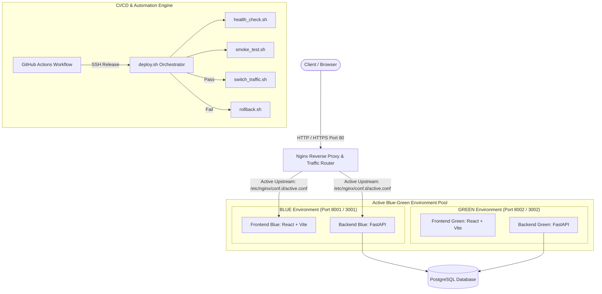

# Zero-Downtime Blue-Green Deployment Platform

A capstone DevOps platform demonstrating **zero-downtime releases**, **blue-green deployment automation**, **automated health verification**, **atomic traffic switching**, **fail-safe rollback mechanisms**, **Infrastructure as Code (Terraform)**, and **GitHub Actions CI/CD pipelines**.

---

## 🏗️ Architecture Overview



---

## 🚀 Quickstart & Local Setup

### Prerequisites
- **Node.js**: `v21.3.0` or higher
- **Python**: `3.10` or higher
- **Docker & Docker Compose**: `v2.20+`

### 1. Local Non-Container Execution
```bash
# Frontend Setup
cd frontend
npm install
npm run build

# Backend Setup
cd ../backend
python -m pip install -r requirements.txt
python -m alembic upgrade head
python -m pytest
```

### 2. Full Containerized Stack via Docker Compose
```bash
# Build and launch PostgreSQL, FastAPI (Blue & Green), React Dashboards, and Nginx Router
docker compose up --build -d

# Verify container statuses
docker compose ps
```

---

## 🔄 Blue-Green Deployment Pattern

The platform maintains two identical application environments running simultaneously:
- **BLUE**: Active environment serving live production traffic.
- **GREEN**: Standby environment targeted for new version releases.

### Deployment Lifecycle Flow (`scripts/deploy.sh`)

1. **Environment Detection**: Inspects Nginx active configuration (`nginx/active.conf`) to identify current production target (`BLUE` vs `GREEN`).
2. **Target Deployment**: Builds and starts the target inactive container stack without affecting the active environment.
3. **Automated Health Probes**: Executes `scripts/health_check.sh` against target port. Retries `/health` up to 12 times with backoff.
4. **Automated Smoke Tests**: Executes `scripts/smoke_test.sh` verifying `/health`, `/version`, and performing temporary Task CRUD API operations against target database.
5. **Atomic Traffic Switch**: On 100% test success, executes `scripts/switch_traffic.sh`, updating `active.conf` and executing `nginx -s reload`.
6. **Automated Rollback Protection**: If health check or smoke test fails, `scripts/rollback.sh` aborts traffic switch, cleans up failed target containers, and maintains current active environment with zero downtime.

---

## 📜 Automation Scripts Reference (`scripts/`)

| Script | Purpose | Usage |
| :--- | :--- | :--- |
| `deploy.sh` | Master deployment orchestrator enforcing zero-downtime release flow | `./scripts/deploy.sh [VERSION_TAG]` |
| `health_check.sh` | Retries `/health` endpoint verification with backoff | `./scripts/health_check.sh <PORT> [MAX_RETRIES]` |
| `smoke_test.sh` | Validates API contracts, version metadata, and DB CRUD ops | `./scripts/smoke_test.sh <PORT> <EXPECTED_ENV>` |
| `switch_traffic.sh` | Atomically updates Nginx active environment link & reloads proxy | `./scripts/switch_traffic.sh <blue\|green>` |
| `rollback.sh` | Restores previous healthy environment and cleans up failed stack | `./scripts/rollback.sh <PREVIOUS_ENV> [FAILED_ENV]` |
| `cleanup.sh` | Removes retired environment containers post-switch | `./scripts/cleanup.sh <ENV_TO_CLEAN>` |

---

## 🛡️ Failure Scenario Matrix

| Scenario | Trigger | Automated Handling | User Experience |
| :--- | :--- | :--- | :--- |
| **Healthy Release** | Deploying `v1.2.0` | Health & smoke tests pass -> Nginx reloads target environment | Zero dropped connections; instant version upgrade |
| **Health Check Failure** | Target app crash or DB connection timeout | `deploy.sh` detects failure -> calls `rollback.sh` -> stops inactive stack | **0% impact**; active environment continues serving users |
| **Smoke Test Failure** | Endpoint schema mismatch or CRUD failure | Smoke suite fails -> pre-switch rollback triggered -> target cleaned | **0% impact**; traffic remains on previous version |
| **Post-Switch Emergency** | Latency spike post-switch | Execute `./scripts/rollback.sh blue green` | Nginx re-routes traffic back to previous pool in < 1s |

---

## ⚙️ Infrastructure as Code (Terraform)

Terraform provisions reproducible AWS cloud infrastructure in `terraform/`:
- **Networking**: VPC, Public Subnet, Internet Gateway, Route Table.
- **Security Groups**: Restricts ingress to HTTP (80), HTTPS (443), and restricted SSH (22).
- **Compute**: EC2 Instance with Amazon Linux 2023, automated Docker & Docker Compose cloud-init (`user_data`), and Static Elastic IP.

### Commands
```bash
cd terraform
terraform fmt
terraform init
terraform plan
# terraform apply (requires explicit AWS credentials)
```

---

## ☸️ Kubernetes Deployment (`k8s/`)

Manifests in `k8s/` support Kubernetes-native Blue-Green deployments:
- `namespace.yaml`: Defines `zero-downtime-platform` namespace.
- `configmap.yaml` & `secret.example.yaml`: Environment configuration and credentials.
- `deployment-blue.yaml` & `deployment-green.yaml`: Pod specs with liveness and readiness probes.
- `service.yaml`: ClusterIP service using selector routing (`environment: blue` or `environment: green`).

---

## 🔒 Security Hygiene Checklist

- [x] No plaintext credentials committed to Git.
- [x] Sensitive variables defined in `.env.example` template.
- [x] Comprehensive `.gitignore` excluding `.env`, `.pem`, `.tfstate`, `node_modules`, `__pycache__`, and `*.db`.
- [x] Backend database migrations managed via Alembic (no implicit `create_all` database wipes).
- [x] Least-privilege AWS IAM policies and restricted security group ingress rules documented.
